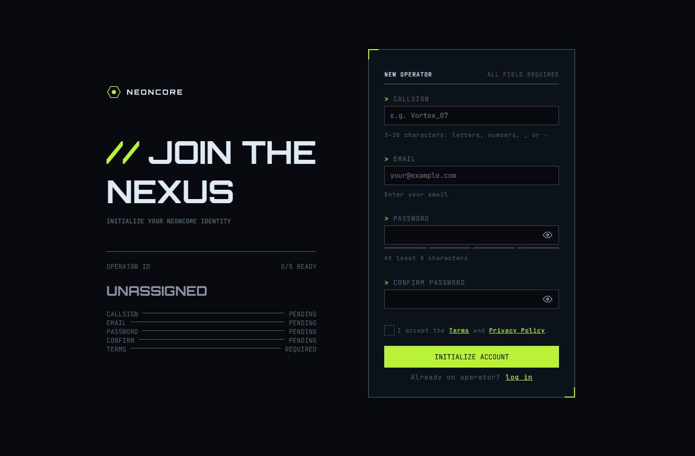
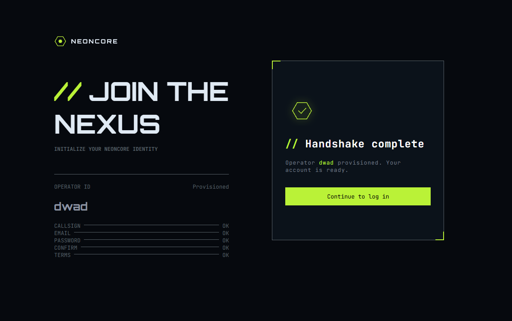

# ⚡ NEONCORE // Gamer Sign-Up Form

> Интерактивная форма регистрации оператора в киберпанк/терминальном стиле с живой валидацией, динамическим дашбордом статусов и анимацией отправки.

[](https://www.frontendmentor.io)
[](https://developer.mozilla.org/ru/docs/Web/HTML)
[](https://developer.mozilla.org/ru/docs/Web/CSS)
[](https://developer.mozilla.org/ru/docs/Web/JavaScript)

---

## 📸 Скриншоты проекта

|                   Форма регистрации                   |                   Экран успеха (Success View)                    |
| :---------------------------------------------------: | :--------------------------------------------------------------: |
|  |  |

---

## 🔗 Ссылки

- **Live Demo (Демо):** [Открыть на GitHub Pages / Vercel](X)
- **Frontend Mentor Solution:** [Посмотреть решение на Frontend Mentor]([https://www.frontendmentor.io/solutions](https://www.frontendmentor.io/solutions/html5-css3-javascript-d_siVgzDDK))

---

## 🚀 Реализованный функционал

### 1. Интерактивная левая панель (Operator Status Hub):

- **Live Callsign Mirroring:** Позывной в реальном времени синхронизируется с надписью `UNASSIGNED` в левой панели. При очистке поля значение корректно сбрасывается обратно.
- **Dynamic Status List:** Таблица статусов с пунктирными линиями (`leader dots` на CSS Flexbox), отображающая готовность каждого поля (`PENDING` / `REQUIRED` ➔ `OK`).
- **Счётчик готовности:** Живой индикатор `[0]/5 READY`, который пересчитывает количество валидных полей при каждом изменении данных.

### 2. Продвинутая валидация и UI формы:

- **Show / Hide Password:** Универсальный переключатель видимости пароля («глазок») на `querySelectorAll` и `.closest()`, независимый для каждого поля пароля.
- **Анализатор надёжности пароля:** Динамический расчёт сложности пароля (0–4 балла) с проверкой длины, цифр, спецсимволов и разного регистра букв через RegExp с анимацией неоновых полосок.
- **Реактивная валидация:** Мгновенная подсветка ошибок под инпутами, вывод статусных иконок (alert / tick) и предотвращение лишних перерисовок через единую функцию `updateFieldUI`.
- **Синхронизация паролей:** Поле подтверждения автоматически перепроверяет совпадение, даже если пользователь вернулся и изменил первый пароль.

### 3. Отправка и Handshake Complete:

- Предотвращение стандартного сабмита формы (`e.preventDefault`).
- Состояние загрузки кнопки (`Transmitting_` с блокировкой кликов).
- Имитация сетевой задержки и бесшовный переход на экран успеха с финальным присвоением статуса `Provisioned`.

---

## 🛠 Стек технологий и технические решения

- **Семантический HTML5:** Грамотная структура (`<aside>`, `<main>`, `<form>`, `<label for="...">`).
- **Модульный CSS3:**
  - Методология **БЭМ** для изоляции стилей компонентов.
  - Гибкая вёрстка на **Flexbox** (распорки на `flex-grow`, динамические пунктиры).
  - Специфичные киберпанк-элементы: декоративные угловые маркеры через псевдоэлементы `::before` / `::after`, двойные неоновые рамки фокуса через `outline` и `outline-offset`.
- **Vanilla JavaScript (ES6+):**
  - Делегирование и обход DOM-дерева (`closest`, `querySelector`).
  - Принцип DRY: единый пайплайн обновления UI для всех полей ввода.
  - Регулярные выражения (RegEx) для комплексной валидации email и паролей.

---

## 💻 Локальный запуск проекта

1. Склонируйте репозиторий:
   ```bash
   git clone https://github.com/your-username/your-repo-name.git
   ```
